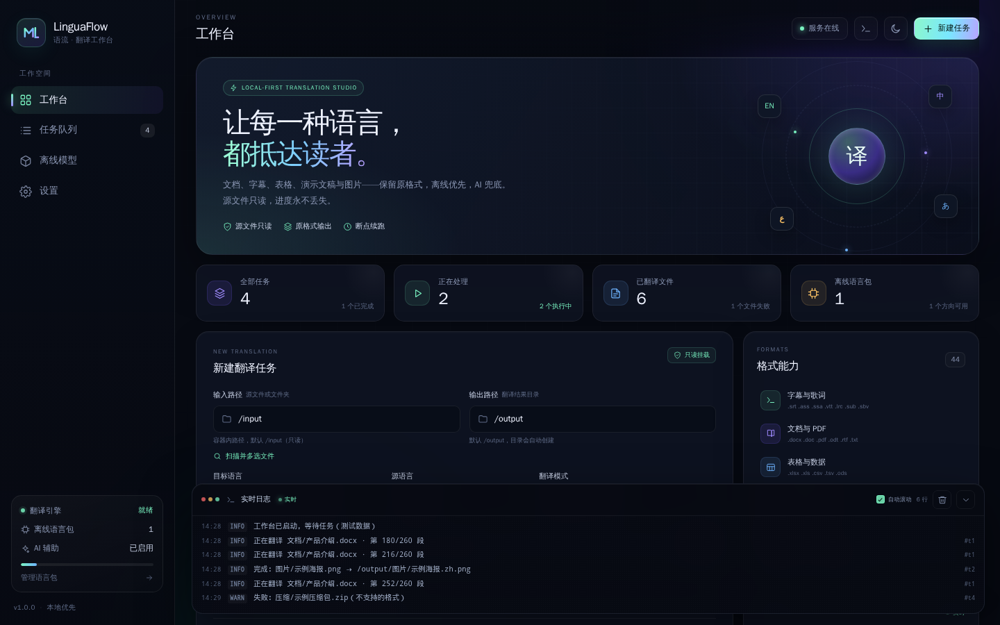
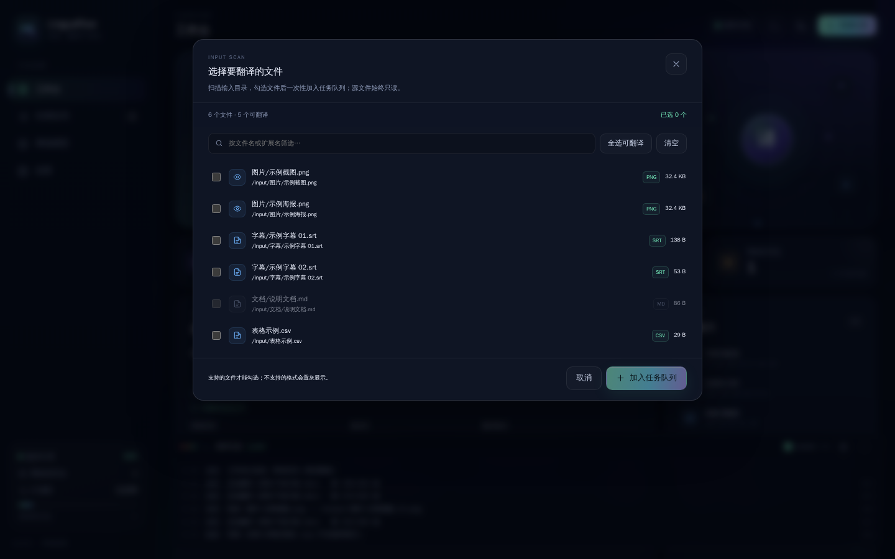
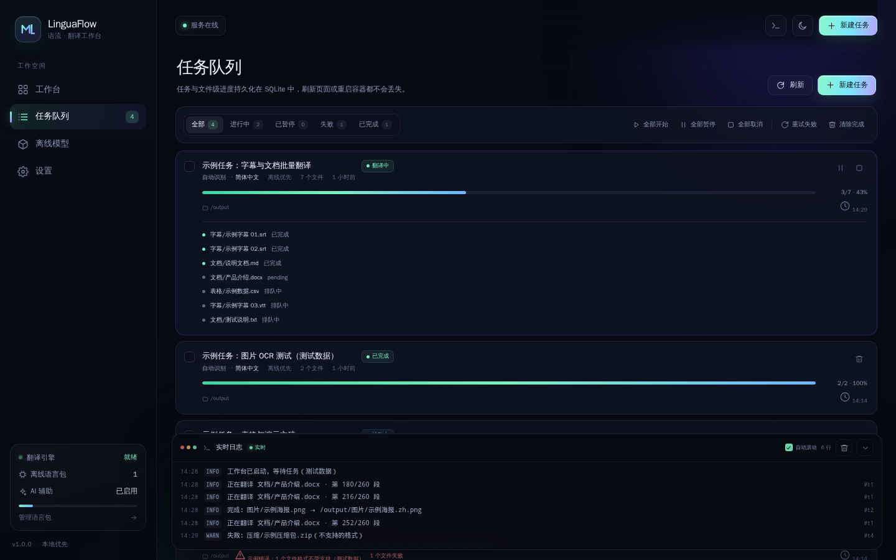
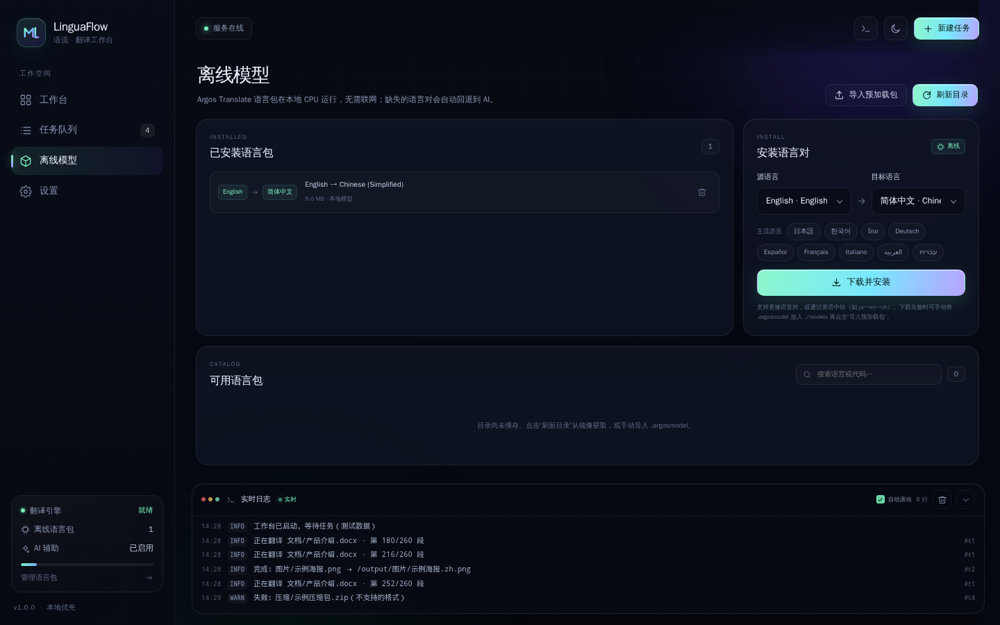
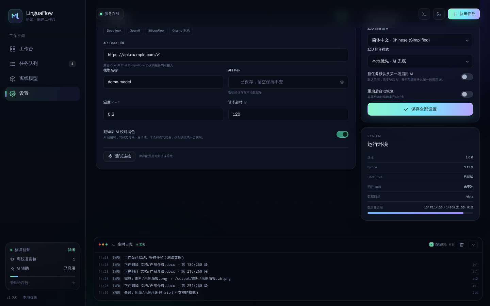
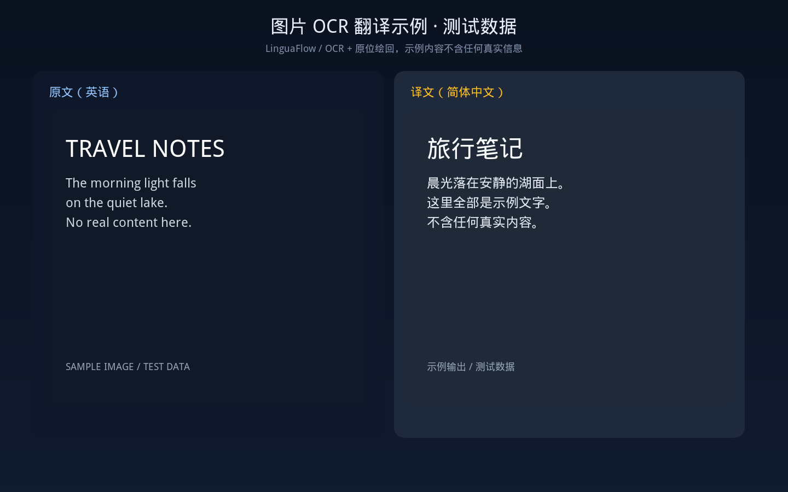
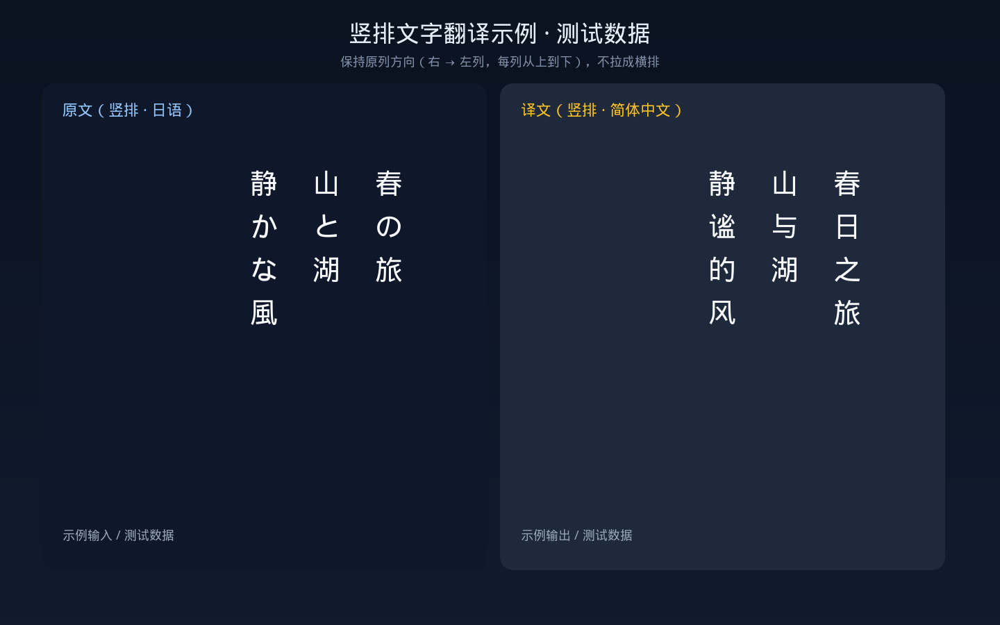

# LinguaFlow · 语流翻译台

> **截图说明**：本仓库 README 中的界面图均为 **容器实际运行的测试数据截图**，示例内容（任务名、文件名、链接、账号等）全部为本地生成的测试数据，不含任何真实链接、账号信息或视频画面。

一个可自托管的文件翻译工作台：Docker Compose 一键启动，浏览器里批量翻译文档、字幕、表格、演示文稿和图片；优先本地离线模型，缺失语言对时自动回退到 DeepSeek / OpenAI 兼容接口。图片会先 OCR 识别文字，再把译文原位绘回，尽量保持字体大小、颜色和排版。



## 为什么是 LinguaFlow

- **文件格式覆盖广**：TXT / LRC / ASS / SRT / VTT / CSV / HTML / DOCX / PDF / XLSX / PPTX，以及 DOC / XLS / PPT / ODT / ODS / ODP / RTF（经 LibreOffice 转换），另有 PNG / JPEG / WebP / AVIF / BMP / TIFF / GIF 图片 OCR。
- **源文件只读**：输入目录以 `:ro` 挂载，程序只读取源文件，翻译结果原子写入输出目录，绝不改动原件。
- **任务不丢**：任务、文件进度、段落进度、日志全部持久化到 SQLite；刷新页面、重启容器、甚至进程被 `kill -9` 后都能恢复。
- **真正的批量控制**：全部开始 / 暂停 / 取消，多选任务批量操作，一键重试全部失败，一键清除已完成记录。
- **默认本地优先**：Argos Translate 模型在容器内 CPU 推理，不联网也能翻译；仓库自带 English → Chinese 模型。需要时可在任务或设置里改成“从一开始就启用 AI”。
- **图片 OCR 翻译**：PNG / JPEG / WebP / AVIF / BMP / TIFF / GIF 自动识别文字，清除原文后把译文绘回原位置；纯色、米色、渐变背景都能无痕替换。
- **AI 兜底**：离线模型不支持的语言对、或离线失败时，自动调用 DeepSeek / 任意 OpenAI 兼容 Chat Completions 接口。
- **AI 校对润色**：翻译完成后可让 AI 再做一遍语法、术语、语气校对；开关在「设置 → AI 辅助翻译」，仅离线模式不会联网。
- **扫描 + 多选**：扫描输入目录的全部文件，按可翻译格式勾选（支持全选/搜索），一次加入同一个任务队列；只处理勾选文件，保留子目录结构。
- **现代化 WebUI**：暗色/亮色主题、实时 SSE 日志、任务进度、模型管理、API 设置，桌面和窄屏都能用。

| 扫描多选 | 任务队列 |
| --- | --- |
|  |  |

| 离线模型 |
| --- |
|  |

| 任务表单 | AI 设置 |
| --- | --- |
|  |  |

## 快速开始

### 1. 准备目录

```bash
cd docker/ai-file-translator
mkdir -p input output data
# preload/ 已自带 en_zh + zh_en；也可以放入其它 .argosmodel
```

### 2. 启动

```bash
docker compose up -d --build
```

打开 <http://服务器IP:5463>。默认端口 **5463**，网络模式 **bridge**。

查看日志：

```bash
docker compose logs -f linguaflow
```

停止：

```bash
docker compose down
```

`data/` 保存数据库、日志和已安装模型；只要保留它，重建容器不会丢任务。

### 重建加速

首次构建仍需安装 LibreOffice、Tesseract 和字体，无法做到几秒完成；下面三种方式解决后续重复构建慢的问题：

1. **只改代码时用重建脚本**（推荐）：

   ```bash
   ./scripts/rebuild.sh
   ```

   它开启 BuildKit，只重新执行最后的 `COPY app` 层；apt/pip 层命中缓存，通常几秒到十几秒。首次运行会自动完成完整构建。

2. **完全不重建，挂载源码调试**：

   ```bash
   docker compose -f docker-compose.yml -f docker-compose.fast.yml up -d
   # 改完 app/ 后
   docker compose -f docker-compose.yml -f docker-compose.fast.yml restart linguaflow
   ```

   `app/` 以只读方式挂进容器，Python/HTML/CSS/JS 改动重启即生效；正式部署不要带这个 override。

3. **改了依赖或 Dockerfile 时**：

   ```bash
   ./scripts/rebuild.sh
   ```

   BuildKit 的 apt/pip cache mount 会复用已下载的包；只有对应层真正变化时才重装。首次构建时间主要花在 LibreOffice/Tesseract/字体上，后续改代码不应再重装它们。

Dockerfile 已改用 LibreOffice 的 `-nogui` 包（保留 doc/xls/ppt/odt/ods/odp/rtf 转换），少装一整套 X11/GUI 依赖，镜像更小、构建更快。注意：本次 Dockerfile 变更后的**下一次**构建仍会重装依赖，这是最后一次完整构建；之后只改 `app/` 就会走快速路径。

### 3. 第一个任务

1. 「工作台」里填输入路径（默认 `/input`）和输出路径（默认 `/output`）。
2. 也可以点输入框下方的「扫描并多选文件」：列出输入目录里的全部文件，勾选需要的文件（可全选可翻译格式），一次加入同一个任务队列。
3. 选择目标语言，例如「简体中文」。
4. 「仅翻译这些源语言」可留空（自动识别所有语言），也可只选 English、Japanese 等。
5. 选择策略：
   - **本地优先 · AI 兜底**（默认）：先本地模型；失败/不支持再调用 AI。
   - **AI 从第一段开始**：从第一段就调用 AI；失败再用本地模型。
   - **仅本地 · 不联网**：完全不出网；缺模型的文件会失败，可稍后重试。
   - 也可以直接拨「从一开始就启用 AI」开关：默认关闭，打开等同第二条策略；切换策略时开关会同步。
6. 点「开始翻译」。任务卡会显示文件数、段落进度和实时日志。

## 输入、输出与命名

输入路径可以是**目录**，也可以是**单个文件**。目录会递归扫描支持的扩展名；符号链接、隐藏文件和本程序临时文件会被跳过。使用「扫描并多选文件」时，只会把你勾选的文件加入任务，未勾选的文件不会处理；相对子目录仍会保留。

输出路径是容器内目录，必须可写，且不能与输入目录相同、互相包含，避免任何覆盖源文件的风险。输出目录不存在会自动创建。

默认输出文件名与源文件一致，保留原扩展名：

```
/input/guide.docx  →  /output/guide.docx
```

可选「自定义输出文件名」，支持占位符：

| 占位符 | 含义 | 示例 |
| --- | --- | --- |
| `{name}` | 原文件名（含扩展名） | `guide.docx` |
| `{stem}` | 不含扩展名的文件名 | `guide` |
| `{ext}` | 扩展名（含点） | `.docx` |
| `{lang}` | 目标语言代码 | `zh` |

示例：

```
{stem}_{lang}{ext}      → guide_zh.docx
{name}_translated       → guide.docx_translated.docx
{stem}_translated{ext}  → guide_translated.docx
```

说明：

- 批量任务使用固定文件名会产生冲突，程序会拒绝；请使用占位符或留空。
- 输出格式始终与源格式一致；若自定义名写了其它扩展名，程序会补上原扩展名，避免“扩展名是 txt、内容却是 docx”。
- 勾选「保留目录结构」时，输出目录会复刻输入目录的层级。
- 同一目录下重名时自动追加 ` (2)`、` (3)`。

## 支持的文件格式

共 44 种扩展名（35 种文档 + 9 种图片；下表含 `.text`/`.log`）：

| 类型 | 扩展名 | 处理方式 | 备注 |
| --- | --- | --- | --- |
| 纯文本 | `.txt` `.text` `.log` | 原生 | UTF-8/UTF-16/GB18030/Big5/Shift_JIS 自动识别，输出 UTF-8 |
| 字幕 | `.srt` `.vtt` `.sub` `.sbv` | 原生 | 保持时间轴与序号 |
| 歌词 | `.lrc` | 原生 | 保持时间标签 |
| ASS/SSA | `.ass` `.ssa` | 原生 | 保持 `[Events]` 格式与样式字段 |
| 表格文本 | `.csv` `.tsv` | 原生 | 保持分隔符；只翻文本单元格 |
| 网页 | `.html` `.htm` `.xhtml` | 原生 | 只翻可见文本，跳过 script/style/code/pre |
| Word | `.docx` `.docm` `.dotx` `.dotm` | 原生 | 正文、表格、页眉页脚、文本框 |
| Word 旧版 | `.doc` | LibreOffice | 先转 docx，翻译后转回 doc |
| PDF | `.pdf` | PyMuPDF | 按文本块重排；**仅文本层 PDF，扫描件不做 OCR** |
| Excel | `.xlsx` `.xlsm` `.xltx` `.xltm` | 原生 | 翻字符串单元格，公式与数字不动 |
| Excel 旧版 | `.xls` | LibreOffice | 先转 xlsx，翻译后转回 xls |
| PowerPoint | `.pptx` `.pptm` `.potx` `.potm` | 原生 | 文本框、表格、组合形状、图表标题、备注 |
| PowerPoint 旧版 | `.ppt` | LibreOffice | 先转 pptx，翻译后转回 ppt |
| OpenDocument | `.odt` `.ods` `.odp` | LibreOffice | 经 docx/xlsx/pptx 中转 |
| RTF | `.rtf` | LibreOffice | 经 docx 中转 |
| 图片 | `.png` `.jpg` `.jpeg` `.webp` `.avif` | Tesseract OCR + Pillow | 原位替换图片文字，保留原格式 |
| 图片 | `.bmp` `.tif` `.tiff` `.gif` | Tesseract OCR + Pillow | GIF 仅支持单帧，动态图会跳过 |

限制：

- PDF 是“文本块重排”，复杂多栏、艺术排版、图内文字可能不完美；加密 PDF 会被跳过。
- Excel 只翻译字符串单元格；公式、数字、日期、布尔值保持原样。
- PPT 图表的数据标签、SmartArt 内部分文字可能无法覆盖。
- 旧版 Office 依赖容器内的 LibreOffice，首次转换较慢。
- 图片 OCR 依赖 Tesseract；复杂照片、强纹理、艺术字体的效果会下降；竖排中日韩文字会按原列方向重排。
- 扫描版 PDF 仍按“无文本层”跳过；需要 OCR 的 PDF 请先导出为图片，再走图片翻译。
- 不支持 DRM 文档、压缩包内文件。

## 图片 OCR 翻译



竖排文字会按原列方向重排（右→左列、每列从上到下），不会把整段拉成横排：



支持 `.png` `.jpg` `.jpeg` `.webp` `.avif` `.bmp` `.tif` `.tiff` `.gif`。处理流程：

1. Pillow 读取图片，保留原格式、尺寸和透明通道；
2. Tesseract 识别文字行与每个词的边界框；小图在低置信度时自动 2× 重试；
3. 自动判断文字方向：横排从左到右、横排从右到左（阿拉伯语/希伯来语），以及竖排从上到下、列从右到左（中日韩竖排）；横排和竖排分别使用对应的 Tesseract 模型；
4. 仍然走正常的“离线优先 → AI 兜底”翻译链路，OCR 只负责取字；图片像素不会上传到 AI；
5. 按背景类型清除原文：纯色/近纯色直接按背景色填充整行；渐变/照片从文字行上下边缘插值重建背景；
6. 用 Noto/WQY 字体把译文绘回原文字框：横排自动缩放、换行、RTL 右对齐；竖排按字符从上到下重绘，列位置和阅读方向保持原样；目标语言不是中日韩时，竖排会以旋转标签方式嵌入，保留原列布局。

建议：

- 截图、海报、PPT 导出图、带字幕的截屏效果最好；文字与背景对比度越高越准。
- 字号很小的图可以先放大 2–4 倍再上传。
- 一张图文字太多时，可以裁成多张分别翻译，排版会更从容。
- GIF/动态 WebP 只处理第一帧会被拒绝；请先导出静态图。

## 主流语言支持

界面提供约 50 种目标语言，常见主流语言都包含在内：

| 语言 | 代码 | 离线 | AI 兜底 |
| --- | --- | --- | --- |
| 简体中文 / 繁体中文 | `zh` / `zt` | 自带 zh↔en；可装其它 | 支持 |
| 英语 | `en` | 可装各语言→en | 支持 |
| 日语 | `ja` | 可装 ja↔en，经 en→zh | 支持 |
| 韩语 | `ko` | 可装 ko↔en | 支持 |
| 泰语 | `th` | AI 为主，可装 en↔th | 支持 |
| 德语 / 法语 / 西班牙语 / 意大利语 | `de` `fr` `es` `it` | 可装 en↔xx | 支持 |
| 阿拉伯语 / 希伯来语 | `ar` `he` | 可装 en↔xx | 支持 |
| 葡萄牙语 / 俄语 / 越南语 / 荷兰语 / 波兰语 / 土耳其语 / 乌克兰语 / 印地语 / 波斯语 | 对应代码 | 视模型目录 | 支持 |

说明：

- “离线”一列取决于本机安装的 Argos 包；模型页可以按语言对下载，`preload/` 也可以预置 `.argosmodel`。
- 没有直接语言包时会自动经英语中转，例如 `ja → en → zh`；中转会损失一点语气，重要内容建议开 AI 校对。
- 没有离线包、或离线失败时，`本地优先` 模式会自动调用已配置的 AI；`仅本地` 模式不会联网。
- 「本地优先」只先查本地缓存；不会因为以前某次 AI 翻译的缓存而跳过本地模型。
- 图片 OCR 的识别语言由源语言决定；`auto` 会尝试已安装的 OCR 语言包。Docker 镜像内置 eng/chi_sim/chi_tra/jpn/kor/tha/deu/spa/fra/ita/ara/heb/por/rus/vie 等常用包，并包含 chi_sim_vert/chi_tra_vert/jpn_vert/kor_vert 竖排模型。

## 离线翻译

### 内置模型

仓库自带两个语言包，启动时会导入到 `/data/models/argos/`：

- `preload/en_zh.argosmodel` — English → Chinese（约 68 MB）
- `preload/zh_en.argosmodel` — Chinese → English（约 72 MB）

所以 **English → Chinese 和 Chinese → English 都开箱即用、完全离线**，不需要先下载模型，也不依赖 AI。`开题报告(3).docx` 这类中文文档只要把目标语言选为 English 即可直接离线翻译。

离线模型偏直译，正式论文/商务材料建议把模式切到「AI 从第一段开始」，或翻译后开启 AI 校对润色。

### 安装其它语言对

进入「离线模型」页：

1. 点「刷新目录」获取 Argos 包索引（需要一次联网）。
2. 选择源语言和目标语言，点「下载并安装」。
3. 安装完成后即可断网使用。

也可以把 `.argosmodel` 放进宿主机的 `./preload/`，重启容器自动导入。手动下载示例：

```bash
curl -L -o preload/ja_en.argosmodel \
  https://argos-net.com/v1/translate-ja_en-1_1.argosmodel
```

### 路由规则

- 有直接语言包时直接翻译。
- 没有直接包时，会尝试经英语中转（如 `ja → en → zh`）。
- 都没有时：`离线优先` 会调用 AI；`仅离线` 会失败并记录原因。

所有推理在容器内 CPU 完成，模型以 int8 运行，不需要 GPU，也不会把文件上传到第三方。

## 接入 DeepSeek / OpenAI 兼容 AI

「设置」→「AI 辅助翻译」：

| 字段 | 说明 |
| --- | --- |
| API Base URL | 例如 `https://api.deepseek.com/v1`、`https://api.openai.com/v1`，或本地 Ollama/vLLM 的 OpenAI 兼容地址 |
| 模型名称 | 例如 `deepseek-chat`、`gpt-4o-mini`、`qwen2.5:7b` |
| API Key | 只保存在 `/data/translator.db`，接口返回时掩码；留空保存表示保持原值 |
| 温度 | 0–2，翻译建议 0.2 |
| 请求超时 | 秒，长文本可调大 |
| 翻译后 AI 校对润色 | 默认开启（AI 启用时生效）；对译文再做一遍语法、术语、语气润色。关闭可省 token |
| 新任务默认从第一段启用 AI | 默认关闭，先本地后 AI；开启后新任务以 `ai_first` 创建，可随时在任务表单里切回 |

内置预设：DeepSeek、OpenAI、SiliconFlow、Ollama 本地。

- 点「测试连接」会发一条极短的测试文本，验证地址、Key、模型是否可用。
- 程序只发送**待翻译的文本片段**，不上传原始文件；单批最多约 900 字符，按段落分块。
- AI 返回非 JSON、段数不匹配、网络失败时会自动重试；仍失败则按策略回退到离线。
- 校对润色会额外发送“源文片段 + 当前译文”给 AI，只改写译文，不会重译；会校验占位符、数字、URL、标签，缺失则保留原译文。校对失败只记 WARN，不会丢掉已翻译结果。
- 「仅离线」模式不会执行校对润色；不配置 AI 也完全可以只用离线模式。

环境变量方式（可选）：

```bash
DEEPSEEK_API_KEY=sk-...
```

写入 `.env` 后 `docker compose up -d`。WebUI 里保存的设置优先于环境变量。

## 任务与进度持久化

- 数据库：`data/translator.db`（SQLite，WAL 模式）。
- 任务状态：`held`（待启动）、`queued`、`running`、`pausing`、`paused`、`cancelling`、`cancelled`、`completed`、`partial`、`failed`。
- 每个文件记录段落总数/已完成数；翻译过程中按 32 段分块检查暂停/取消信号，长任务也能在 1–2 秒内响应。
- 输出先写临时文件 `.<name>.lf-part-<uuid>`，成功后再 `os.replace` 原子替换；中断不会留下半个目标文件。
- 重启容器时：
  - `running` 的文件重置为待处理；
  - 暂停/取消中的任务回到可恢复状态；
  - `auto_resume=true` 时，队列中的任务自动继续；
  - 已完成文件不会重复翻译（已写入输出）。
- 页面刷新只重连 SSE 日志，不会影响后台线程。

## 全部/批量操作

任务页工具栏：

- **全部开始**：启动所有可启动任务（暂停、失败、部分完成、待启动）。
- **全部暂停**：暂停运行中/排队中的任务；当前段落处理完后落盘。
- **全部取消**：取消所有活动任务。
- **重试失败**：把所有含失败文件的任务重新排队，失败文件重试。
- **清除完成**：只删除 `completed` 状态的任务记录，不删除输出文件，也不删除翻译缓存。

勾选任务左侧复选框后，底部出现批量操作条，可对选中任务执行开始/暂停/取消/重试/删除。删除只允许已结束任务，运行中的任务需先取消。

## Docker Compose 配置

```yaml
services:
  linguaflow:
    build: .
    image: linguaflow:1.0.0
    container_name: linguaflow
    restart: unless-stopped
    network_mode: bridge
    ports:
      - "5463:5463"
    volumes:
      - "${HOST_INPUT_DIR:-./input}:/input:ro"
      - "${HOST_OUTPUT_DIR:-./output}:/output"
      - ./data:/data
      - "${HOST_PRELOAD_DIR:-./preload}:/opt/argos-preload:ro"
```

| 挂载 | 作用 | 权限 |
| --- | --- | --- |
| `${HOST_INPUT_DIR:-./input}:/input` | 源文件 | **只读** |
| `${HOST_OUTPUT_DIR:-./output}:/output` | 翻译结果 | 读写 |
| `./data:/data` | SQLite、模型、日志、LibreOffice 缓存 | 读写 |
| `${HOST_PRELOAD_DIR:-./preload}:/opt/argos-preload` | 启动时自动导入的离线模型 | 只读 |

### 自定义输入/输出文件夹

两种方式：

1. 复制 `.env.example` 为 `.env`，把 `HOST_INPUT_DIR` / `HOST_OUTPUT_DIR` 指向你的目录（例如 `/volume1/docs`、`/volume1/translated`）；容器内仍是 `/input`、`/output`，WebUI 默认值不用改。
2. 保留挂载，在 WebUI 里填写容器内路径（例如把多个目录挂到 `/docs-a`、`/docs-b`，任务里填对应路径）。路径必须是容器内可见的目录或文件。

### 环境变量

| 变量 | 默认 | 说明 |
| --- | --- | --- |
| `TZ` | `Asia/Shanghai` | 日志时区 |
| `MAX_TASK_WORKERS` | `2` | 同时运行的任务数；CPU 弱可设 1 |
| `DEEPSEEK_API_KEY` | 空 | 可选的 AI Key 初始值 |
| `HOST_INPUT_DIR` | `./input` | 宿主机源文件目录（只读挂载到 `/input`） |
| `HOST_OUTPUT_DIR` | `./output` | 宿主机结果目录（挂载到 `/output`） |
| `HOST_PRELOAD_DIR` | `./preload` | 宿主机离线模型目录 |
| `WEB_PORT` | `5463` | 对外端口（容器内固定 5463） |
| `MAX_LOG_ROWS` | `30000` | 日志保留上限 |

## Windows `.exe`

`exe/LinguaFlow.exe` 是 Windows x64 桌面启动器（6.7 MB，无 Python/Office 依赖）：

1. 双击后检查 LinguaFlow 服务是否在线；
2. 在线则用默认浏览器打开 WebUI；
3. 不在线则弹窗提示，可点「重试」。

首次运行会在 exe 同目录生成 `linguaflow.json`：

```json
{ "server": "http://192.0.2.10:5463" }
```

也可以：

```bat
LinguaFlow.exe -server http://192.0.2.10:5463
LinguaFlow.exe -status
```

> `.exe` 是 **WebUI 的 Windows 伴侣/启动器**，翻译引擎仍在 Docker 容器内运行。这样 Windows 端无需安装 Python、LibreOffice 或任何模型。

重新构建（Linux/macOS 交叉编译）：

```bash
cd desktop
./build.sh
```

## HTTP API（便于自动化）

所有接口返回 JSON；无认证，建议只在内网使用。

| 方法 | 路径 | 作用 |
| --- | --- | --- |
| GET | `/api/health` | 健康检查 |
| GET | `/api/bootstrap` | 语言、设置、格式、统计 |
| GET/POST | `/api/tasks` | 任务列表 / 新建任务 |
| POST | `/api/scan` | 扫描输入目录，返回文件清单与可翻译标记 |
| POST | `/api/tasks/batch` | `{action, ids}` 批量操作 |
| POST | `/api/tasks/retry-failed` | 重试全部失败 |
| POST | `/api/tasks/clear-completed` | 清除已完成记录 |
| POST | `/api/tasks/{id}/start\|pause\|cancel\|retry` | 单任务操作 |
| GET | `/api/logs` | 增量日志 |
| GET | `/api/logs/stream` | SSE 实时日志 |
| GET | `/api/models` | 已安装/可下载模型 |
| POST | `/api/models/refresh` | 刷新模型目录 |
| POST | `/api/models/download` | 下载安装语言对 |
| GET/PUT | `/api/settings` | 读取/保存设置 |
| POST | `/api/ai/test` | 测试 AI 连接 |
| GET | `/api/system` | 版本、磁盘、LibreOffice、离线模型状态 |

新建任务示例：

```bash
curl -X POST http://127.0.0.1:5463/api/tasks \
  -H 'Content-Type: application/json' \
  -d '{
    "input_dir": "/input",
    "output_dir": "/output",
    "target_lang": "zh",
    "source_lang": "auto",
    "source_filter": ["en", "ja"],
    "mode": "offline_first",
    "output_name": "{stem}_{lang}{ext}",
    "preserve_tree": true,
    "auto_start": true
  }'
```

扫描输入目录示例：

```bash
curl -X POST http://127.0.0.1:5463/api/scan \
  -H 'Content-Type: application/json' \
  -d '{"path": "/input"}'
```

返回 `files[]`，每项包含 `path`、`rel`、`size`、`supported`。勾选后把绝对路径放进新建任务的 `files` 数组即可：

```json
{
  "name": "扫描选择 · 2 个文件",
  "input_dir": "/input",
  "output_dir": "/output",
  "target_lang": "zh",
  "files": ["/input/a.txt", "/input/sub/b.srt"],
  "preserve_tree": true,
  "auto_start": true
}
```

## 安全与隐私

- 默认无登录认证，**不要直接暴露到公网**。需要远程访问时，请放在 Nginx/Caddy 反向代理和认证之后。
- 输入目录只读挂载；程序对源文件只执行读取。
- API Key 仅存于容器数据卷，`GET /api/settings` 永远返回空字符串，只给 `api_key_set` 布尔值。
- AI 模式会把待翻译文本发送到你配置的 AI 服务；开启校对润色时还会发送源文片段和当前译文。仅离线模式完全不出网。
- PDF/DOCX 等文件在容器内临时目录处理，成功后原子移动到输出目录。

## 数据备份/升级

```bash
# 备份
tar czf linguaflow-data-$(date +%F).tar.gz data/

# 升级
docker compose build --pull
docker compose up -d
```

升级前请先备份 `data/`。当前数据库会在首次启动时自动创建；若未来版本包含结构变更，以对应版本的升级说明为准。

## 常见问题

**任务一直 `held`？**  
新建任务时关闭了「创建后立即开始」。点任务卡上的开始，或全选后批量开始。

**提示没有离线语言包？**  
到「离线模型」页安装对应语言对；或把 `.argosmodel` 放入 `preload/` 后重启。没有直接语言对时会尝试经英语中转。

**PDF 输出没有变化/文字很少？**  
源 PDF 可能是扫描件，没有文本层。PDF 页面 OCR 暂未内置；请先把页面导出为 PNG/JPEG，再用「图片 OCR」翻译。

**旧版 `.doc/.xls/.ppt` 失败？**  
确认容器内 LibreOffice 可用：

```bash
docker compose exec linguaflow soffice --version
```

查看任务日志里的 `LibreOffice 转换失败` 详情。

**AI 测试失败？**  
检查 Base URL 是否包含 `/v1`、模型名、Key、容器到 AI 服务的网络。Ollama 在宿主机时，Linux 下可用 `http://172.17.0.1:11434/v1`（bridge 网关），并确保 Ollama 监听 `0.0.0.0`。

**端口 5463 被占用？**  
改 compose 的 `ports: "5463:5463"` 左侧宿主端口，容器内仍保持 5463。

**日志面板挡住内容？**  
点右上角终端图标收起，或拖到底部后点 chevron 折叠；主区域可正常滚动。

## 上机检查清单（Docker 未在开发机执行）

开发环境没有 Docker，但已在本机 LibreOffice 25.2.3 + Tesseract 上验证 35 种文档和 9 种图片。以下项目仍需在真实 NAS/服务器上确认：

- [ ] `docker compose config` 通过，`network_mode: bridge` 与 `5463:5463` 生效。
- [ ] `docker compose up -d --build` 构建成功，健康检查变为 healthy。
- [ ] 浏览器打开 `http://IP:5463`，工作台/任务/模型/设置四页无 JS 报错。
- [ ] `input/` 只读挂载下能扫描文件；源文件哈希前后不变。
- [ ] 自带 `en_zh` / `zh_en` 模型首次启动成功导入，断网后 English ↔ Chinese 仍可翻译。
- [ ] 中文 `.docx` 目标语言 English 可离线完成（本机已验证 210 段 / 约 21 秒）。
- [ ] `.doc`、`.xls`、`.ppt`、`.odt`、`.ods`、`.odp`、`.rtf` 经容器内 LibreOffice 转换并输出原格式（开发机 LibreOffice 25.2.3 已通过 35/35 矩阵；容器版本不同，首次构建后仍建议复跑）。
- [ ] 暂停/取消长任务在 2 秒内响应；重启容器后任务状态与段落进度保留。
- [ ] DeepSeek/OpenAI 兼容接口测试通过，离线失败时自动回退。
- [ ] `docker compose down` 后 `data/translator.db` 仍在，重新启动任务列表不丢。
- [ ] 中文、日文、韩文、阿拉伯文 PDF 字体可读（容器已装 WQY/Noto CJK/DejaVu）。
- [ ] 图片 OCR：PNG/JPEG/WebP/AVIF 各传一张，检查译文位置、颜色、背景无明显补丁；确认动态 GIF 被跳过。
- [ ] 文字方向：横排中/英/阿语各一张；竖排日文两列、竖排中文、竖排韩文各一张，检查列序右→左、每列从上到下、译文顶端对齐且不压到相邻列。
- [ ] 阿拉伯语/希伯来语图片译文从右向左、字符相连；泰语上下标完整。

## 目录结构

```
.
├── app/                 # Python 标准库 HTTP 服务 + 翻译引擎 + 格式处理器
│   ├── engines/         # 离线模型、模型仓库、OpenAI 兼容客户端
│   ├── formats/         # TXT/字幕/Office/PDF/图片处理器
│   ├── ocr.py           # Tesseract 识别与语言选择
│   └── static/          # 无构建步骤的 HTML/CSS/JS
├── desktop/             # Go 源码：Windows 启动器
├── exe/LinguaFlow.exe   # 已交叉编译的 Windows x64 启动器
├── preload/             # 启动时自动导入的 .argosmodel
├── input/               # 默认源目录（只读挂载）
├── output/              # 默认输出目录
├── data/                # 运行时数据（数据库/模型/日志）
├── docker/entrypoint.sh
├── Dockerfile
├── docker-compose.yml
└── docs/screenshots/
```

## 第三方组件

- [Argos Translate](https://github.com/argosopentech/argos-translate) / OpenNMT 模型（离线翻译）
- [CTranslate2](https://github.com/OpenNMT/CTranslate2)、[SentencePiece](https://github.com/google/sentencepiece)
- [PyMuPDF](https://pymupdf.readthedocs.io/)、[python-docx](https://python-docx.readthedocs.io/)、[openpyxl](https://openpyxl.readthedocs.io/)、[python-pptx](https://python-pptx.readthedocs.io/)
- LibreOffice（旧版 Office/OpenDocument 转换）
- [Tesseract OCR](https://github.com/tesseract-ocr/tesseract)、[Pillow](https://python-pillow.org/)、[OpenCV](https://opencv.org/)
- 字体：WenQuanYi Micro Hei、Noto CJK/Noto Naskh Arabic/Noto Sans Hebrew/Thai、DejaVu

本项目代码可自由修改；第三方模型和库遵循各自许可。
